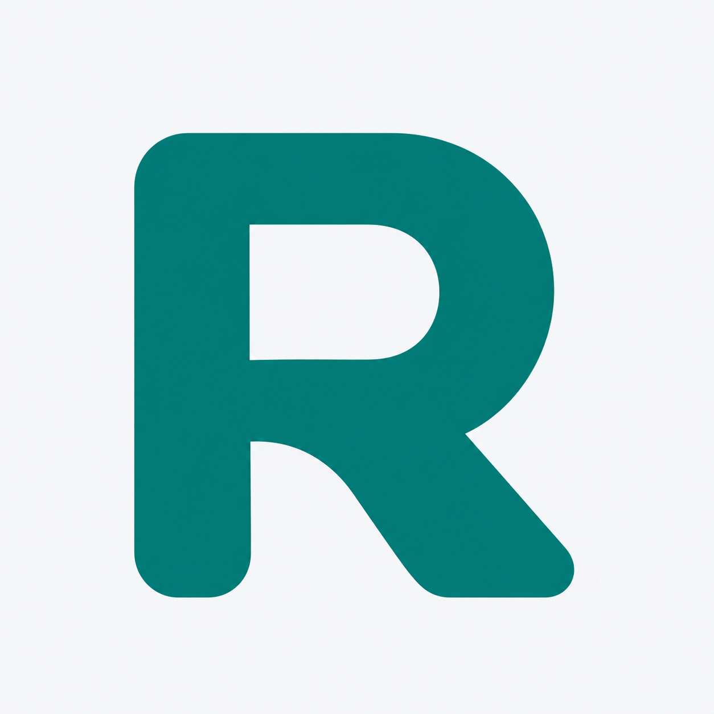

# Rillane Logo · B 紧凑几何定稿

三张独立概念稿，使用内置 image_gen 生成并原样保存；用户已选定 B（紧凑几何）。已按轮廓重建正式 SVG，原始生成候选保留供追溯。

[GitHub 原图目录](https://github.com/cuihairu/rillane/tree/main/docs/public/brand/v1) · [提示词与文件清单](https://github.com/cuihairu/rillane/blob/main/docs/public/brand/v1/concepts.json)

## 正式标志

深青色 `#007F78`，透明背景。正式 SVG 由简洁闭合路径构成，无字体和内嵌位图。

## 原始候选

### A · 柔和流线

圆润连贯的水流形成 R，强调顺畅连接。

尺寸：1254 × 1254。

### B · 紧凑几何

用更紧凑的几何轮廓表达稳定内核。

尺寸：1254 × 1254。

### C · 双通道融合

两条并行通道汇成 R，呼应网页与游戏并行。

尺寸：1254 × 1254。

## 正式交付

[SVG 与使用说明](https://github.com/cuihairu/rillane/tree/main/docs/public/brand/v1/final) · [256px PNG](../../public/brand/v1/final/rillane-symbol-256.png)。README/文档站已引用新 SVG，浏览器使用 favicon.svg。
