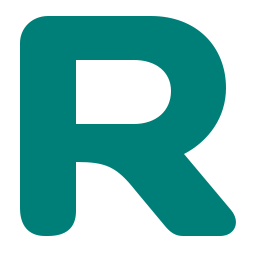

# Rillane Logo · B 紧凑几何

用户选定 B。原始 AI 概念图保留在上级目录；本目录是依据该方向重新构建的矢量交付件，以 `rillane-symbol.svg` 为主源。



## 文件选择

| 用途 | 文件 |
| --- | --- |
| 默认标志，透明背景 | [rillane-symbol.svg](rillane-symbol.svg) |
| 单色印刷或黑色场景 | [rillane-symbol-black.svg](rillane-symbol-black.svg) |
| 深色底反白 | [rillane-symbol-white.svg](rillane-symbol-white.svg) |
| 圆角应用图标预览 | [rillane-app-icon.svg](rillane-app-icon.svg) / [512px PNG](rillane-app-icon-512.png) |
| 透明 PNG | `rillane-symbol-{16,24,32,48,64,128,256,512,1024}.png` |
| 黑色 / 白色透明 PNG | `rillane-symbol-black-256.png` / `rillane-symbol-white-256.png` |
| 浏览器图标、Apple touch icon、移动图标导出 | `web/` |
| 不同背景与尺寸的检视页 | [preview.html](https://github.com/cuihairu/rillane/blob/main/docs/public/brand/v1/final/preview.html) |

## 使用规则

- 主色为深青色 `#007F78`，反白为 `#FFFFFF`，单黑为 `#000000`。
- SVG 画布为 256 × 256；保留画布留白，外侧另留至少标志高度的 1/8，避免贴边。
- 保持等比缩放，不拉伸、不加阴影，不替换局部颜色。深色背景使用反白版。
- 已渲染检查 16px、32px、反白与应用图标。小尺寸使用给定 PNG 或 favicon，不再叠加细节。
- `rillane-app-icon.svg` 是圆角展示版；`web/icon-512.png` 等平台导出具有各自留白，按平台规范选用。原生应用发布前仍需生成对应资源目录和平台尺寸。

## 当前接入

README 与文档站沿用 `docs/public/logo.svg`，已替换为此主标志。文档站使用 `docs/public/favicon.svg`，并提供 32px PNG fallback 和 Apple touch icon。

`web/site.webmanifest` 仅为交付模板，图标路径相对于该文件；当前站点未启用 PWA。`web/head-snippet.html` 是现有资源路径的接入示例。

## 维护

修改主 SVG 后同步 `docs/public/logo.svg`，并重新导出 PNG。透明 PNG 可使用以下命令生成（将尺寸替换为所需值）：

```sh
rsvg-convert -w 256 -h 256 rillane-symbol.svg -o rillane-symbol-256.png
```

SVG 不含字体、栅格图片、滤镜或外部依赖。原始候选与提示词见上级目录 `concepts.json`，不要用概念 PNG 覆盖正式矢量源。
